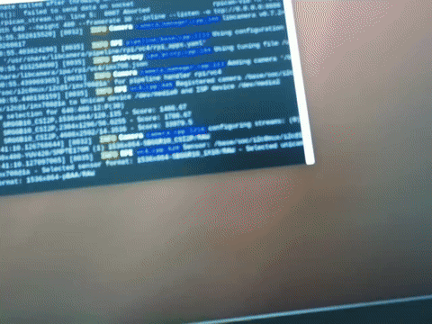
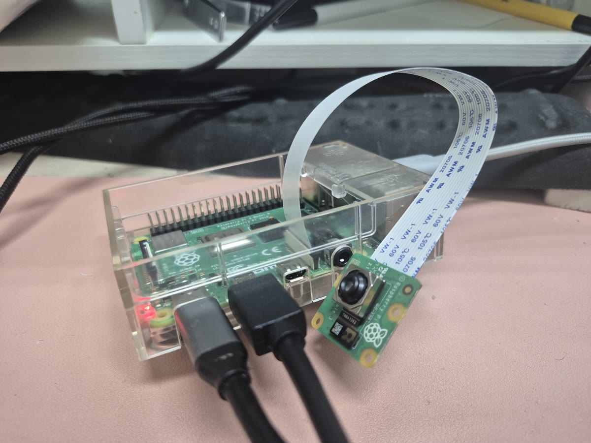

# Raspberry Pi 4 카메라 영상 스트리밍



Pi 카메라로 Pi 터미널(송출 실행)과 PC 수신 화면을 찍은 영상. 원본: [docs/demo.mp4](docs/demo.mp4)

---

## 결론: 무엇을 고르면 되나

| 결정할 것 | 권장 | 근거 (실측) |
|---|---|---|
| 실시간 자세 피드백 네트워크 | **같은 공유기** | 송출 지연 38ms vs 인터넷 185~358ms |
| 원격 모니터링·녹화 | Tailscale(인터넷) 가능 | FPS는 30 유지, 지연은 0.1~2초 |
| 자세 인식(추론) 위치 | **PC** | PC 30fps vs Pi 단독 6.9fps |
| 해상도 | **640x480** | 1280x720은 지연 +17ms, 추론은 어차피 축소 |
| Pi 화면에 미리보기 | 켜도 됨 | CPU +12%p, 80% 이상 여유 |
| Pi WiFi 절전 | **끄기** | 네트워크 지연 p95 129ms → 27ms |
| 여러 PC 동시 수신 | 현재 방식은 불가 | TCP 1:1 연결. 필요하면 RTSP 서버로 교체 |

---

## 구성



```
Camera Module 3 ─CSI─> Pi 4 (rpicam-vid, HW H.264 인코딩) ─TCP:8888─> 수신 PC
```

| 항목 | 내용 |
|---|---|
| 전송 | TCP. Pi가 `<Pi IP>:8888`에서 대기, 수신 측이 접속 |
| 영상 | H.264 raw stream (컨테이너 없음), 640x480, 30fps |
| 인코딩 | Pi 하드웨어 H.264 인코더 (CPU 거의 안 씀) |
| 연결 수 | 1곳. 끊기면 1초 뒤 자동으로 다시 대기 |

**실시간으로 만든 방법**

- 하드웨어 인코딩: 촬영 → 전송이 약 28ms.
- 파일 저장 없이 인코딩된 프레임을 바로 소켓으로 전송.
- `--inline`: 키프레임마다 디코딩 정보(SPS/PPS)를 넣어 언제 접속해도 바로 재생.
- 수신 측 버퍼 최소화: `ffplay -fflags nobuffer`.
- Pi WiFi 절전 끄기: 전송이 묶여 나가며 지연이 튀는 것을 방지.

TCP라 화면이 깨지지 않는다. 대신 네트워크가 불안정하면 재전송 때문에 지연이 튄다.

---

## 사용법

**송출 (Pi)**

```bash
./pi_rpicam_stream.sh      # 송출만
./pi_stream_preview.sh     # 송출 + Pi 화면에 미리보기
```

**수신 (PC)** — 같은 영상을 받는 두 가지 방법

```bash
# 화면으로 보기만
ffplay -fflags nobuffer -f h264 tcp://<Pi IP>:8888
```

```python
# 코드에서 프레임 처리 (예: 자세 인식)
cap = cv2.VideoCapture("tcp://<Pi IP>:8888")
ok, frame = cap.read()
```

`<Pi IP>`: 같은 공유기면 `192.168.1.101`, 인터넷이면 Tailscale 주소 `100.120.99.44`.

---

## 측정 결과

### 같은 공유기 vs 인터넷

인터넷: PC를 폰 핫스팟에 연결하고 Tailscale로 접속. 30초씩 2회.

| 항목 | 같은 공유기 | 인터넷 (1회 / 2회) |
|---|---|---|
| 수신 FPS | 31.0 | 29.4 / 30.5 |
| 송출 지연 평균 (촬영 → PC 수신) | **38ms** | **358ms / 185ms** |
| 네트워크 지연 중간값 | 4.9ms | 128ms / 105ms |
| 네트워크 지연 p95 | 27ms | 1501ms / 516ms |
| 네트워크 지연 최대 | 147ms | 2137ms / 917ms |
| PC 추론 FPS | 29.8 | 11.9 / 13.8 |
| ping 손실 | 0% | 6.7% |

- 인터넷은 지연이 약 5~10배이고, 가끔 1~2초씩 멈췄다 몰려온다.
- FPS는 유지된다. TCP가 늦더라도 프레임을 빠짐없이 보내기 때문이다.
- 프레임이 몰려 도착하면 추론은 최신 프레임만 처리해 FPS가 절반 이하로 떨어진다.

### 해상도별 (같은 공유기, PC 추론 포함)

| 설정 | 촬영 → 인식 완료 평균 | p95 | PC 추론 FPS |
|---|---|---|---|
| 640x480, WiFi 절전 끔 | **68ms** | 89ms | 29.8 |
| 640x480, WiFi 절전 켬 | 71ms | 96ms | 25.9 |
| 1280x720, WiFi 절전 끔 | 85ms | 119ms | 28.3 |
| Pi 단독 추론 (비교) | - | - | 6.9 |

추론: YOLO11n-pose, PC CPU (Ryzen 7 8845HS).

### Pi 부하 (PC 수신 30fps 유지)

| 경우 | CPU (4코어 전체) | RAM | 최고 온도 |
|---|---|---|---|
| 송출만 | 3.2% | 413MB | 54.5°C |
| 송출 + 화면 미리보기 | 15.6% | 444MB | 56.4°C |
| 송출 + 화면 미리보기, 1280x720 | 16.8% | 458MB | 57.9°C |

스로틀링·전압 부족 없음.

### 측정 방법

- 지연: 같은 인코더·설정으로 프레임마다 촬영 시각(`SensorTimestamp`)을 붙여 보내는 `pi_stream_server.py`로 측정.
- 두 기기 시계는 NTP 방식으로 맞췄다. 오차는 같은 공유기 ±1ms, 인터넷 ±20ms.
- 같은 공유기는 설정별 20초(약 600프레임), 인터넷은 30초씩 2회.
- 화면 표시에 드는 시간(약 16~33ms)은 포함하지 않았다.

---

## 최초 1회 설정 (Pi)

```bash
sudo ufw allow from 192.168.1.0/24 to any port 8888 proto tcp   # 같은 공유기만 허용
sudo iw dev wlan0 set power_save off                            # 재부팅 시 다시 켜짐
```

---

## 스펙

| | |
|---|---|
| 보드 | Raspberry Pi 4 Model B, 4GB |
| 카메라 | Camera Module 3 (IMX708) |
| OS | Raspberry Pi OS 64bit (Debian 13) |
| 네트워크 | 5GHz WiFi |
| 수신 PC | Ryzen 7 8845HS, CPU 추론 |

---

## Tailscale (인터넷으로 받기)

### 왜 Tailscale인가

- Pi 주소 `192.168.1.101`은 공유기 안에서만 통한다.
- 공유기 포트포워딩은 스트림에 비밀번호·암호화가 없어 누구나 볼 수 있게 된다.
- Tailscale은 등록된 기기끼리만 암호화된 연결을 만든다. 공유기 설정이 필요 없다.

### 현재 구성

| 항목 | 값 |
|---|---|
| Pi 기기 이름 | `aiot-pi` |
| Pi Tailscale 주소 | `100.120.99.44` |
| 계정 | 팀 공유 Tailscale 계정 |
| Pi 방화벽 | `tailscale0`에서 오는 8888(스트림), 8890(지연 측정) 허용 |
| 자동 실행 | Pi 재부팅 시 Tailscale 자동 연결 |

### 새 PC에서 받는 방법

방법 A: 공유 계정으로 로그인 (팀원 PC 권장)

```bash
sudo tailscale up          # 출력되는 링크에서 공유 계정으로 로그인
tailscale status           # 목록에 aiot-pi가 보이면 성공
```

방법 B: 개인 계정 그대로 쓰고 Pi만 공유받기

1. 공유 계정으로 https://login.tailscale.com/admin/machines 접속.
2. `aiot-pi` → `...` → **Share** → 받을 사람 이메일 입력.
3. 받은 사람이 초대 링크를 열어 수락.

수신:

```bash
ffplay -fflags nobuffer -f h264 tcp://100.120.99.44:8888
```

### 연결 경로 확인

```bash
tailscale ping 100.120.99.44
```

| 출력 | 의미 |
|---|---|
| `via <IP>:41641` | 직접 연결(P2P). 가장 빠름 |
| `via DERP(tok)` | Tailscale 중계서버(도쿄) 경유. 더 느림 |

처음 몇 번은 중계서버를 거치다가 몇 초 안에 직접 연결로 바뀌는 것이 정상이다.

### 자주 생기는 문제

| 증상 | 해결 |
|---|---|
| `aiot-pi` 이름으로 접속이 안 됨 | 공유받은 기기는 짧은 이름이 안 된다. IP `100.120.99.44` 사용 |
| `Access denied: profiles access denied` | 계정 추가·전환은 `sudo` 필요 |
| PC Tailscale이 `Logged out` | `sudo tailscale switch --list` 후 원래 계정으로 `sudo tailscale switch <계정>` |
| 접속 시간 초과 | Pi에서 `tailscale status`, `sudo ufw status`로 연결·방화벽 확인 |
